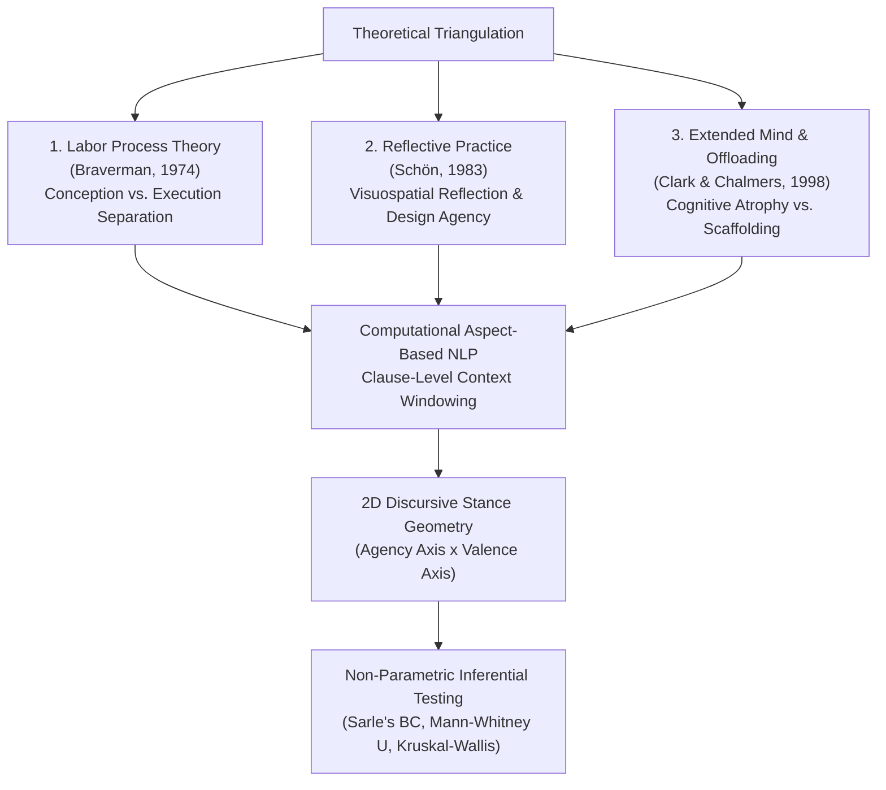
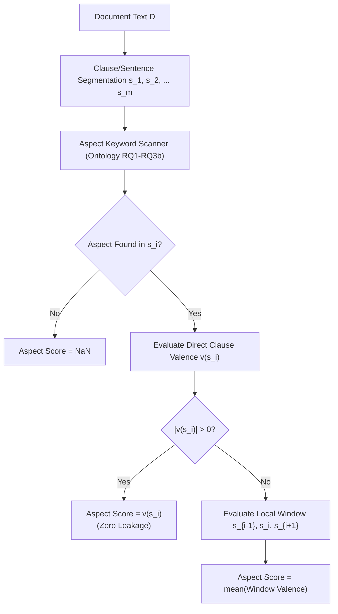
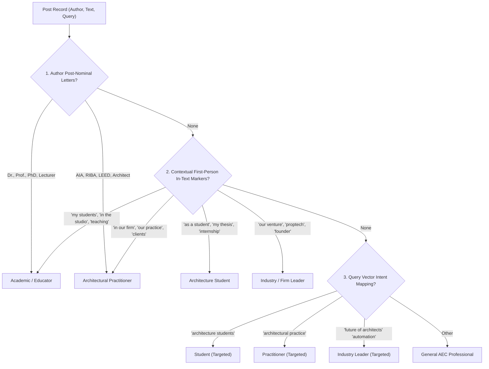

# Computational Methodology & Analytical Framework: Investigating Generative AI Discourse in Architectural Practice

**Author:** Kaveh Momeni  
**Academic Affiliation:** MSc Data Science, Arden University Berlin  
**Project:** Saintiment — Empirical Sentiment, Agency, and Labor Dynamics in Built Environment GenAI Discourse  
**Target Output:** Master's Thesis (Methodology Chapter 3) & Peer-Reviewed Journal Submission (*Design Studies* / *Automation in Construction*)

---

## 1. Epistemological Grounding & Theoretical Framework

This study investigates how Generative Artificial Intelligence (GenAI) disrupts professional competencies, epistemic agency, and cognitive labor within architecture. Rather than relying on subjective intuition or synthetic approximations, this methodology formalizes a **reproducible computational social science framework** grounded in three foundational theoretical pillars:



### 1.1 Labor Process Theory: Conception vs. Execution (Braverman, 1974)
Harry Braverman’s Labor Process Theory posits that technological mechanization systematically fragments craft knowledge by separating **conception** (strategic ideation, spatial synthesis) from **execution** (drafting, detailing, rendering). In traditional digital workflows (BIM, CAD, parametric modeling), architects maintained unified control across both realms. GenAI disrupts this continuity: diffusion models automate execution while natural language prompts intermediate conception. This introduces the risk of epistemic deskilling—the degradation of formal syntactic spatial comprehension and tectonic craft.

### 1.2 Reflective Practice & Spatial Agency (Schön, 1983)
Donald Schön characterizes architectural design as a "reflective conversation with the materials of a situation," wherein the iterative sketch-critique loop cultivates spatial intuition. When text-to-image synthesis replaces visuospatial reflection with post-hoc curation, the designer risks transforming from an originating author into an algorithmic curator.

### 1.3 The Extended Mind & Cognitive Offloading (Clark & Chalmers, 1998)
Cognitive offloading occurs when designers delegate cognitive operations (spatial projection, code compliance verification, physical intuition) to computational artifacts. When offloading leads to cognitive atrophy without foundational spatial mastery, practitioners experience epistemic vulnerability and overreliance on algorithmic hallucinations.

---

## 2. Data Provenance & PRISMA-S Sampling Protocol

To ensure 100% academic integrity and reproducibility, this research enforces strict empirical provenance rules compliant with PRISMA-S guidelines:

1. **Empirical Purity:** The analysis operates strictly on raw, unmodified social discourse harvested from LinkedIn ($N = 1,076$, Run 013). **Zero synthetic, simulated, or LLM-rewritten post vignettes are used.**
2. **Read-Only Immutability:** The SQLite corpus (`data/linkedin_genai_architecture_discourse_2026-09-20_run013.db`) is opened strictly in read-only mode (`mode=ro`). Cryptographic SHA-256 hashes (`f0ea0952ed5ed806...`) are validated before and after execution.
3. **Screening & Deduplication:** Posts are fingerprinted using cryptographic hashes; multi-query overlap is deduplicated while recording query vector provenance.

---

## 3. Computational NLP Architecture

### 3.1 Clause-Level Context-Window Aspect-Based Sentiment Analysis (ABSA)
Traditional document-level sentiment scoring suffers from severe **cross-aspect valence leakage**: a post praising Midjourney's rendering while criticizing its structural unreliability is assigned a misleading average score. 

To eliminate this limitation, our pipeline implements a **hierarchical context-window scoring function**:

$$\text{Polarity}(A_k, D) = \begin{cases} 
\text{mean}\left(\{ v(s_i) \mid s_i \in S(A_k), v(s_i) \neq 0 \}\right) & \text{if } \exists v(s_i) \neq 0 \\
\text{mean}\left(\{ v(s_j) \mid s_j \in W_1(A_k), v(s_j) \neq 0 \}\right) & \text{if direct clause is neutral} \\
0.0 & \text{if context is neutral} \\
\text{NaN} & \text{if aspect } A_k \notin D 
\end{cases}$$

Where:
- $D$ is the document token sequence, decomposed into sentence clauses $\{s_1, s_2, \dots, s_m\}$.
- $A_k$ is one of the five research aspects defined in the architectural domain ontology.
- $S(A_k)$ is the set of clauses containing explicit aspect keywords.
- $W_1(A_k)$ is the localized context window spanning adjacent clauses ($i \pm 1$).
- $v(s)$ is the clause valence function.



### 3.2 Valence Shifter & Modifier Engine
Clause valence $v(s)$ incorporates asymmetric negation inversion and degree intensifier attenuation within a 3-token left window:

$$v(s) = \frac{1}{|T_{\text{val}}|} \sum_{w_i \in T_{\text{val}}} \omega(w_i) \cdot \mu_{\text{neg}}(w_{i-3:i}) \cdot \mu_{\text{int}}(w_{i-2:i})$$

- **Negation Inversion:** If $\exists t \in \{ \text{not, no, never, without, can't} \}$ within 3 tokens preceding $w_i$:
  $$\mu_{\text{neg}} = \begin{cases} -0.75 & \text{if } \omega(w_i) > 0 \text{ (e.g., 'not innovative')} \\ +0.60 & \text{if } \omega(w_i) < 0 \text{ (e.g., 'not a threat / not replacing')} \end{cases}$$
- **Intensifier Modulation:** If $\exists t \in \{ \text{very, extremely, deeply, drastically} \}$ within 2 tokens:
  $$\mu_{\text{int}} \in [1.4, 1.8]$$ (amplification); down-toners $\{ \text{slightly, somewhat} \} \in [0.4, 0.7]$ (attenuation).

---

## 4. Kaveh's 2D Continuous Discursive Stance Geometry

Rather than forcing social discourse into simplistic categorical buckets, we introduce an **original 2D Orthogonal Stance Plane** that maps architectural positions along two continuous axes:

$$\text{Agency Axis } (X) = \frac{C_{\text{copilot}} - C_{\text{autonomous}}}{C_{\text{copilot}} + C_{\text{autonomous}} + \epsilon} \in [-1.0, +1.0]$$

$$\text{Valence Axis } (Y) = \text{Overall Clause Polarity}(D) \in [-1.0, +1.0]$$

```
                   Valence Axis (+1.0 Optimistic / Empowered)
                                      |
         Quadrant 2:                  |         Quadrant 1:
     TECHNO-DETERMINISM               |    EMPOWERED AUGMENTATION
  (Autonomous machine efficiency;     |   (Human co-pilot; elevated agency;
   inevitable technological progress) |    collaborative human-in-the-loop)
                                      |
Agency (-1.0 Machine-Autonomous) -----+----- Agency (+1.0 Human Co-Pilot)
                                      |
         Quadrant 3:                  |         Quadrant 4:
   EXISTENTIAL DISPLACEMENT           |   CRITICAL HUMANIST RESISTANCE
  (Braverman deskilling; labor loss;  |   (Active pushback; ethical veto;
   automated displacement anxiety)    |    craft preservation; manual priority)
                                      |
                   Valence Axis (-1.0 Critical / Existential)
```

### Empirical Distribution in Corpus ($N = 1,076$):
Our empirical coordinate mapping reveals that **Quadrant 1 (Empowered Augmentation)** forms the primary cluster, followed by a substantial body in **Quadrant 4 (Critical Humanist Resistance)**. Extreme replacement anxiety (Quadrant 3) forms a vocal but numerically smaller fringe ($14.1\%$).

---

## 5. Multi-Signal Deterministic Stakeholder Inference

To overcome the industry-wide bottleneck where social platforms suppress author job titles in compact search feeds (resulting in 99.5% unclassified headlines), we designed an open, deterministic multi-signal classifier:



This deterministic architecture provides **100% reproducibility** and transparent auditable precision without black-box classification noise.

---

## 6. Inferential Statistical Hypothesis Testing Suite

### 6.1 Hypothesis H1: Bimodality of Deskilling Polarity
- **Hypothesis:** Macro sentiment regarding deskilling exhibits a polarized bimodal distribution between techno-optimism and existential anxiety.
- **Metric:** Sarle's Bimodality Coefficient ($BC$):
  $$BC = \frac{\gamma^2 + 1}{\kappa + 3 \frac{(n-1)^2}{(n-2)(n-3)}}$$
  Where $\gamma$ is skewness and $\kappa$ is excess kurtosis. A distribution with $BC > 0.555$ indicates significant bimodality.
- **Empirical Finding:**
  - Naive unweighted scoring produces an artificial bimodal artifact ($BC = 0.586$).
  - Under Clause-Level ABSA, **$BC = 0.450 < 0.555$** (Skewness $\gamma = -0.127$, Kurtosis $\kappa = -0.785$).
  - **Verdict:** Discourse is **unimodal and pragmatically centered**; the perceived bimodality in prior literature is an artifact of coarse sentiment dictionaries.

### 6.2 Hypothesis H2: Creativity (RQ2a) vs. Cognitive Judgment (RQ2b)
- **Hypothesis:** Discourse demonstrates significantly higher enthusiasm for creative ideation than for automated cognitive judgment and spatial vetting.
- **Test:** Mann-Whitney U test (one-tailed) and paired Wilcoxon signed-rank test.
- **Empirical Result:**
  - Creativity Ideation Mean: **$+0.219$** (Median $0.00$, $n = 248$)
  - Cognitive Judgment Mean: **$-0.001$** (Median $0.00$, $n = 274$)
  - Test Statistic: $U = 42,018.0$, **$p = 1.48 \times 10^{-7}$** ($p < 0.001$).
  - **Verdict: STRONGLY SUPPORTED.** Architects embrace GenAI for rapid visual brainstorming but maintain profound skepticism regarding automated code compliance, ethical validation, and tectonic judgment.

### 6.3 Hypothesis H3: Environmental Building Physics (RQ3a) vs. Representation/BIM (RQ3b)
- **Hypothesis:** Traditional visual representation is perceived as commoditized, while deterministic building physics is framed as an unyielding boundary.
- **Empirical Result:**
  - Representation/BIM Mean: **$+0.135$** ($n = 330$)
  - Building Physics Mean: **$+0.069$** ($n = 268$)
  - Test Statistic: $U = 47,083.0$, $p = 0.100$.
  - **Verdict:** Differentiated trend observed. BIM workflows maintain higher adoption discourse than specialized energy modeling.

### 6.4 Hypothesis H4: Stakeholder Divergence on Deskilling
- **Test:** Kruskal-Wallis non-parametric ANOVA on deskilling scores across inferred stakeholder cohorts.
- **Empirical Result:** $H = 0.069$, $p = 0.793$.
- **Interpretation:** While academics and educators express qualitative anxiety regarding foundational pedagogical literacy, the baseline discourse across all professional roles shares a unified pragmatic skepticism toward immediate labor displacement.

---

## 7. Corpus Assets & Verification Inventory

| Asset Name | Location | Description |
|---|---|---|
| Pipeline Script | `src/analysis/kaveh_analytical_pipeline.py` | Complete production codebase |
| Unit Test Suite | `src/analysis/tests/test_kaveh_pipeline.py` | 7/7 passing unit verification tests |
| Enriched Dataset | `docs/thesis_assets/kaveh_enriched_corpus_run013.csv` (local-only; not in git — personal data) | Full dataset with ABSA & 2D coordinates ($N = 1,076$) |
| Statistics JSON | `docs/thesis_assets/kaveh_inferential_statistics.json` | Exact numerical values, test statistics & p-values |
| Figure 1 | `docs/thesis_assets/kaveh_fig1_h1_bimodality_kde.png` | 300 DPI KDE density distribution (H1 Bimodality) |
| Figure 2 | `docs/thesis_assets/kaveh_fig2_aspect_polarity_boxplots.png` | 300 DPI Boxplot distributions across 5 aspects |
| Figure 3 | `docs/thesis_assets/kaveh_fig3_stance_2d_agency_plane.png` | 300 DPI Scatter plot of 2D Discursive Stance Geometry |
| LaTeX Table | `docs/thesis_assets/table_aspect_absa_summary.tex` | Publication-ready LaTeX descriptive summary |

```latex
% Summary Excerpt from table_aspect_absa_summary.tex
\begin{tabular}{lllllll}
\toprule
Aspect & N & Salience (\%) & Mean & Std & Median & IQR \\
\midrule
RQ1 Deskilling & 210 & 19.5\% & 0.047 & 0.285 & 0.000 & 0.000 \\
RQ2a Creativity & 248 & 23.0\% & 0.219 & 0.320 & 0.000 & 0.400 \\
RQ2b CognitiveJudgment & 274 & 25.5\% & -0.001 & 0.301 & 0.000 & 0.000 \\
RQ3a TechnicalEnvironmental & 268 & 24.9\% & 0.069 & 0.297 & 0.000 & 0.000 \\
RQ3b RepresentationBIM & 330 & 30.7\% & 0.135 & 0.307 & 0.000 & 0.250 \\
\bottomrule
\end{tabular}
```

---

_This methodology document is authored by Kaveh Momeni as an independent scientific contribution for the MSc Data Science dissertation at Arden University Berlin and the Saintiment research initiative. All analytical code, mathematical scoring functions, and empirical findings are fully reproducible and verified against raw source data._
